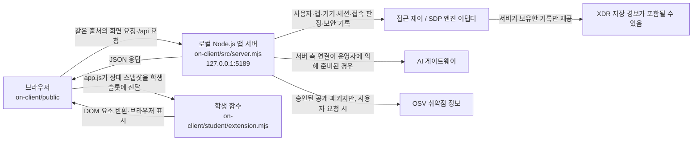

# 학생 실행 설명서와 구성도

확인 기준일: 2026-10-23

이 문서는 현재 프로젝트 파일과 실행 코드를 읽어 작성했습니다. 실행을 직접 해 보지 않은 항목은 확인됨으로 표시하지 않습니다. 기존 `README.md`와 `docs/STUDENT_LAUNCH_GUIDE.md`는 그대로 둡니다.

## 1. 프로젝트 위치와 폴더 구조

현재 PC에서 확인한 Git 최상위 폴더는 `C:\Users\user\Desktop\choi-bujang-secret-vault`입니다. 앱 코드와 앱용 `package.json`은 그 아래 `on-client`에 있습니다. Git 작업·커밋은 최상위 폴더에서 하고, 앱 실행 명령은 `on-client` 폴더의 PowerShell에서 실행합니다.

```text
choi-bujang-secret-vault/              Git 최상위 폴더
├─ aleph.config.json                   ALEPH 프로젝트 설정
├─ package.json, package-lock.json     바깥 프로젝트의 설정·잠금 파일
├─ docs/                               바깥 프로젝트 문서
└─ on-client/                          이 문서가 설명하는 로컬 웹 앱
   ├─ package.json                     앱 이름·Node 요구 버전·실행 스크립트
   ├─ .env.example                     비밀 없는 설정 변수 이름 안내
   ├─ docs/                            앱 안내·계약·문제 해결 문서
   ├─ public/                          브라우저 화면과 제공 UI
   ├─ src/                             로컬 HTTP 서버와 서버 측 모듈
   ├─ student/                         학생 구현: extension.mjs
   ├─ tools/                           시작 도구: start-alekov.ps1
   └─ vendor/                          앱에 포함된 런타임 모듈
```

확인한 파일 상태: `on-client/package.json`은 `start: node src/server.mjs`, `demo: node src/server.mjs --demo`, `check: node --check student/extension.mjs`를 정의하고 `node` 버전 `24.19.0`을 지정합니다. 앱 폴더에는 `package-lock.json`이 없고, 바깥 Git 최상위에는 있습니다. 취약점 조회 대상 프로젝트는 서버의 `ON_PROJECT_DIRECTORY` 설정으로 정해지므로, 실제 실행에서 그 값이 가리키는 폴더는 확인하지 않았습니다.

## 2. 필요 프로그램과 확인한 버전

| 항목 | 프로젝트 기준 | 이 PC에서 확인한 값 |
|---|---|---|
| Windows PowerShell | `tools/start-alekov.ps1` 실행에 필요 | 사용 가능. PowerShell 버전은 확인하지 않음 |
| Node.js | 실행 도구는 22~24 지원, 수업 기준 및 앱 `engines`는 24.19.0 | `node --version` → `v24.19.0` |
| 앱 시작 틀 | `on-client/package.json`의 패키지 버전 | `0.2.11` |
| npm | `npm start` 대체 실행에만 사용. 앱 `package.json`에는 npm 버전 고정 없음 | `npm --version` → `11.17.0` |
| 브라우저 | 로컬 주소를 여는 브라우저 | 종류·버전 및 화면 동작은 확인하지 않음 |

버전 명령은 실행해 확인했지만, 앱 서버·브라우저는 실행하지 않았습니다. 별도 `npm install`이나 패키지 변경은 이 안내의 실행 절차에 필요하지 않습니다.

## 3. PowerShell에서 실행·종료·재실행

1. 파일 탐색기에서 `C:\Users\user\Desktop\choi-bujang-secret-vault\on-client` 폴더를 엽니다.
2. 탐색기 주소 표시줄에 `powershell`을 입력하고 Enter를 눌러 그 위치에서 PowerShell을 엽니다. 다른 방법은 PowerShell에서 아래 명령으로 앱 폴더로 이동하는 것입니다.

```powershell
Set-Location "C:\Users\user\Desktop\choi-bujang-secret-vault\on-client"
```

3. 앱 폴더에서 시작 도구를 실행합니다.

```powershell
powershell -NoProfile -ExecutionPolicy Bypass -File .\tools\start-alekov.ps1
```

`-ExecutionPolicy Bypass`는 이 실행 한 번에만 적용됩니다. 도구는 Node 버전, 앱 폴더, 기본 포트 `5189` 사용 여부와 로컬 HTTP 응답을 확인합니다. 정상 시작 시 도구가 안내하는 주소는 `http://127.0.0.1:5189/`입니다. 안내된 URL을 브라우저에서 직접 엽니다. 시작 도구의 정상 신호는 다음 두 메시지입니다.

```text
케셰브가 켜졌습니다. 브라우저에서 http://127.0.0.1:5189/ 을 여세요.
서버가 응답한 것만 확인했습니다. AI 연결 상태는 화면에서 따로 확인해 주세요.
```

이 메시지는 로컬 서버가 응답했다는 뜻입니다. SDP·XDR 또는 AI 게이트웨이 연결 성공을 의미하지 않습니다. 시작 도구가 없는 다른 사본에서는 앱 폴더에서 `npm start`를 실행할 수 있지만, 이 방법은 시작 도구의 사전 Node·포트 확인을 수행하지 않습니다. 현재 확인한 사본에는 시작 도구가 있습니다.

- **종료:** 서버를 실행한 PowerShell 창에서 `Ctrl+C`를 누릅니다.
- **재실행:** 같은 앱 폴더의 PowerShell에서 위 시작 명령을 다시 실행하고 같은 주소를 엽니다.
- **기본 포트가 사용 중일 때:** 다른 프로그램을 종료하지 말고 시작 명령 끝에 `-Port 5190`을 붙입니다. 브라우저 주소도 `http://127.0.0.1:5190/`으로 바꿉니다.

## 4. 구성과 데이터 흐름



글로 풀면, 브라우저는 제공 UI를 표시하고 같은 로컬 서버에 화면 자료를 요청합니다. `src/server.mjs`가 요청을 서버 측 엔진·어댑터로 전달합니다. SDP 연결은 담당자가 제공한 설정이 있는 경우에만 사용할 수 있으며 기본 실행만으로 연결되었다고 볼 수 없습니다. 보안 기록에 포함되는 XDR 경보는 서버가 이미 저장해 제공한 자료입니다. AI 관련 요청도 브라우저가 AI 업체에 직접 보내는 구조가 아니라 앱 서버 경로를 거치며, 실제 이용 가능 여부는 운영자 측 계정 권한·앱 설정·게이트 준비에 달려 있습니다. 패키지 조회는 서버가 지정한 프로젝트의 lock 파일과 허용 목록을 사용하고, 학생 렌더러가 OSV를 직접 호출하지 않습니다.

현재 기본 포트는 서버 코드의 `ON_PORT` 또는 기본값 `5189`입니다. 서버는 `127.0.0.1`에 바인딩합니다. `.env.example`에는 `ON_PORT`, `ON_ENGINE_ADAPTER`, `ON_AI_MODEL`, `ON_PROJECT_DIRECTORY`, `ON_APPROVED_PUBLIC_PACKAGES` 변수 이름이 있습니다. 실제 값·비밀 설정은 이 문서에 적지 않았고, 그 값들이 현재 PC에서 설정되어 있는지도 확인하지 않았습니다.

## 5. 제공 코드와 학생 구현 경계

| 영역 | 코드 위치 | 역할과 확인 범위 |
|---|---|---|
| 제공 화면 | `public/index.html`, `public/app.js`, `public/style.css` | 메뉴·버튼·요청·취소·응답 세대 확인·학생 렌더러 호출을 담당합니다. 제공 코드는 수정 대상이 아닙니다. |
| 로컬 서버 | `src/server.mjs` | 정적 파일과 `/api/*` 요청을 처리하고, 설정된 엔진·스캐너·AI 연결을 서버 측에서 호출합니다. |
| 취약점 응답 표시/검사 | `public/vulnerabilities-view.mjs`, `src/vulnerabilities/` | 제공 화면은 응답 계약을 검사하고 서버 모듈은 lock 파일 및 허용 공개 패키지를 조회합니다. 조회 결과는 사용자가 「설치 패키지 조회」를 눌러 받은 자료입니다. |
| 학생 화면 함수 | `student/extension.mjs` | 제공 화면이 전달한 입력을 DOM으로 표시합니다. 확인한 함수: `renderIdentity`, `renderDecision`, `renderEvents`, `renderStatus`, `renderVulnerabilities`, `renderAiConnection`, `renderExplanation`, `renderAction`. |
| 시작 도구 | `tools/start-alekov.ps1` | 실행 폴더·Node 버전·포트·HTTP 응답을 확인한 뒤 서버를 시작하고 주소를 안내합니다. |

학생 함수는 전달받은 응답 상태를 표시합니다. 그 자체로 로그인, SDP 승인, 정책 판정, OSV 조회, AI 연결, XDR 탐지 또는 실제 조치 집행을 수행하지 않습니다. `renderAction`은 제공 화면에서 전달된 조치 상태만 보여 주며, 요청 버튼과 서버 호출은 제공 코드가 관리합니다.

## 6. 기능 확인과 미확인 항목

| 항목 | 코드에서 읽어 확인한 내용 | 실제 화면/외부 연결 확인 |
|---|---|---|
| 메뉴와 학생 영역 | 제공 UI가 `renderStudent`로 학생 함수를 호출하고 반환 결과로 영역을 교체합니다. | 새 PowerShell 창·브라우저로 실행해 보지 않음 |
| 사용자·기기·세션 및 접속 판정 | 학생 함수가 받은 자료의 사용자·기기·세션 및 판정 상태를 표시합니다. | 현재 계정의 실제 값과 비교하지 않음 |
| 보안 기록 | 학생 함수는 기록·필터·상세 입력을 표시하고, XDR은 이미 전달된 저장 경보에 한정됩니다. | 실제 기록·필터·상세를 조작하지 않음 |
| 패키지 취약점 | 제공 UI가 취소 및 새 요청 세대를 관리하고, 서버 응답 계약은 `complete/partial/not_checked/not_configured/unverifiable` 및 패키지별 결과를 구분합니다. | OSV 결과·부분 조회·오류·lock 해시 갱신을 확인하지 않음. `ON_PROJECT_DIRECTORY`와 허용 목록의 실제 값도 확인하지 않음 |
| AI 연결·설명 | 제공 UI와 서버에 분리된 연결/설명 경로가 있고, 학생 함수는 받은 상태·설명을 표시합니다. | 승인, 실제 게이트 응답, 사건 설명 성공을 확인하지 않음 |
| 조치 상태 | 학생 함수는 준비·전달·접수·관측·거절·실패·불명 상태를 표시합니다. | 실제 대상이나 조치 집행은 시도하지 않음. 현재 기록의 지원 조치도 확인하지 않음 |
| 실행 명령·버전 | `package.json`, 시작 스크립트, Node/npm 버전을 읽거나 조회했습니다. | 서버 시작 메시지와 브라우저 페이지는 직접 확인하지 않음 |

### 오류가 있을 때 확인 순서

| 증상 | 확인 순서 |
|---|---|
| `Node.js 가 없습니다` 또는 지원 버전 안내 | 새 PowerShell에서 `node --version`을 확인하고, 수업 기준 `v24.19.0`을 설치한 뒤 앱 폴더에서 다시 실행합니다. |
| 포트 `5189` 사용 중 | 기존 프로그램을 임의로 종료하지 않습니다. 시작 명령에 `-Port 5190`을 붙이고 브라우저도 `:5190` 주소로 엽니다. |
| 앱 폴더/시작 틀 오류 | PowerShell 현재 위치가 실제 `on-client` 폴더인지, `tools\start-alekov.ps1`과 `src\server.mjs`가 있는지 확인합니다. |
| 시작 도구가 정해진 시간 안에 서버 응답을 받지 못함 | 실행 창의 전체 오류를 확인하고 기존 파일을 지우거나 초기화하지 않습니다. `docs/CONNECTION_TROUBLESHOOT.md`에서 해당 오류를 찾고, 해결되지 않으면 담당자에게 오류와 도움정보를 전달합니다. |
| 화면에서 `연결 없음`, `확인 불가`, `요청 실패`가 표시됨 | 먼저 화면에 표시된 상태와 오류 코드를 확인합니다. 서버가 켜졌다는 사실만으로 외부 연결이 성공했다고 보지 않습니다. SDP·계정·AI 설정은 담당자가 제공한 안내가 있을 때만 점검합니다. |
| 패키지 조회가 실패/부분 확인/미조회 | `error`, `partial`, `not_checked`, 패키지별 `unverifiable`을 구분합니다. 취약점 없음으로 바꾸지 말고, 필요하면 사용자가 설치 패키지 조회를 직접 다시 요청합니다. |

세부 연결 오류 코드와 담당자 확인이 필요한 항목은 [CONNECTION_TROUBLESHOOT.md](CONNECTION_TROUBLESHOOT.md)를 따릅니다. 키·토큰·비밀번호·설정 파일 원문을 문서나 채팅에 복사하지 않습니다.

## 7. 실행 재현 체크리스트

- [ ] 기존 작업 폴더와 파일을 그대로 둔 채 새 PowerShell을 열었습니다.
- [ ] PowerShell 위치가 `on-client` 앱 폴더입니다.
- [ ] 시작 도구가 출력한 URL을 브라우저 주소창에 입력했습니다.
- [ ] 정상 시작 메시지를 실제로 확인했습니다.
- [ ] 보호 현황·업무 앱·보안 기록 메뉴와 설치 패키지 조회 버튼을 실제로 확인했습니다.

이 체크리스트는 실행 기록이 아닙니다. 작성 시점에는 버전 명령만 직접 실행했고, 앱 실행·브라우저 조작·연결·취약점 조회 항목은 미확인입니다.